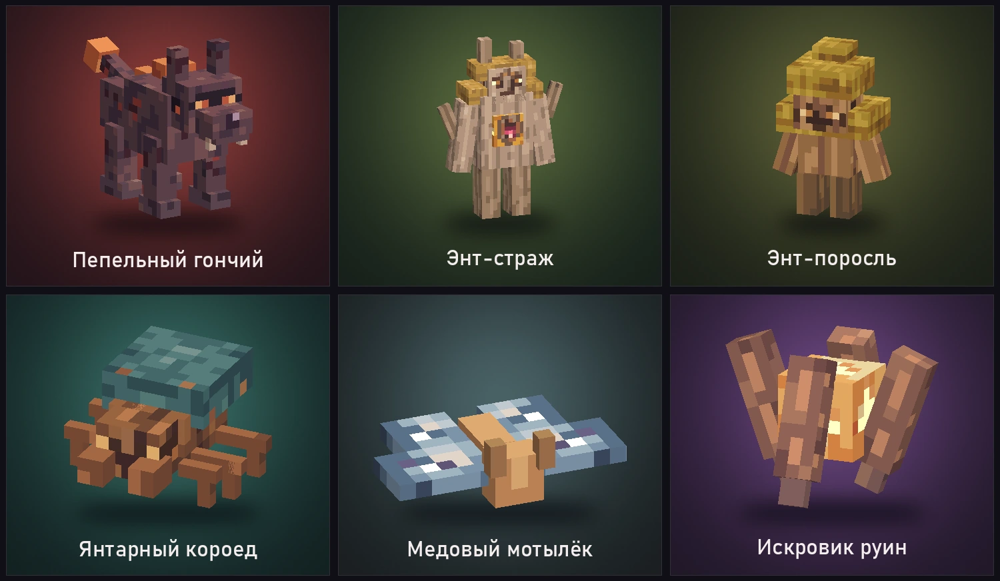

# MagicRPG

MagicRPG — аддон для Thaumcraft 4: Reforged на Minecraft 26.3. Он добавляет измерения со своей атмосферой и обитателями. Открывай их одно за другим: в каждом следующем мире испытания сложнее.

## Чудовищные твари



*Мобы отрисованы из игровых моделей и текстур MagicRPG.*

## Лиловые луга

Над белыми грядами поднимаются лиловые кристаллы, а в траве мелькают звёздные зайцы. Меловые стражи бродят у скал, где старая обсерватория нависает над обрывом. Под лугами фиолетовый свет струится по каналам погребённого города. На галереях ещё ходят пустые доспехи, а под светящейся печатью над воротами ждёт паладин с двуручным клинком. Среди руин остались редкие находки для будущих опытов на алтаре.

## Сборка

Установи **JDK 25** и укажи его в `JAVA_HOME`. Gradle отдельно устанавливать не нужно. Для сборки и запуска используются следующие JAR:

- `thaumcraft-4-reforged-1.1.3-26.3.jar`
- `TerraBlender-neoforge-26.3-26.3.0.0.9.jar`

Gradle ищет эти файлы сначала в `libs/`, затем в каталоге из `-PprofileMods`. На Windows без этого параметра используется `%APPDATA%\.minecraft\mods`. Reforged и TerraBlender устанавливаются отдельно и не входят в артефакт MagicRPG.

```powershell
.\gradlew.bat build -x test
# Если моды хранятся в другом каталоге
.\gradlew.bat build -x test '-PprofileMods=D:\Minecraft\test-profile\mods'
```

Первая сборка загружает Gradle и зависимости, поэтому ей нужен доступ к сети. Результат — `build/libs/magicrpg-<версия>-26.3.jar`. Для установки положи его в `mods` вместе с Reforged и TerraBlender.

## Локальная проверка

| Команда на Windows | Каталог запуска |
| --- | --- |
| `.\gradlew.bat runClient` | `run/client/` |
| `.\gradlew.bat runServer` | `run/server/` |

При первом запуске выделенный сервер потребует принять Minecraft EULA в своём каталоге. Эти команды используют окружение разработки. Для проверки установочного JAR положи его в отдельный профиль или отдельный сервер с нужными зависимостями.

Версия разработки — NeoForge `26.3.0.115`. Нижняя граница в метаданных Reforged 1.1.3 — `26.3.0.57-beta`. Игра запускалась на `26.3.0.115`, в том числе с Sodium и Horizon Iris.

- [Релиз Reforged 1.1.3 для Minecraft 26.3](https://github.com/notlikethiss/thaumcraft-4-reforged/releases/tag/26.3)
- [Исходники Reforged по тегу 26.3](https://github.com/notlikethiss/thaumcraft-4-reforged/tree/26.3)
- [Инструкции для Codex](AGENTS.md)

## Разработка

- [Маршруты по коду и ресурсам](docs/development-workflows.md)
- [Пересборка карты Златолесья](docs/development-workflows.md#пересборка-карты-златолесья)
