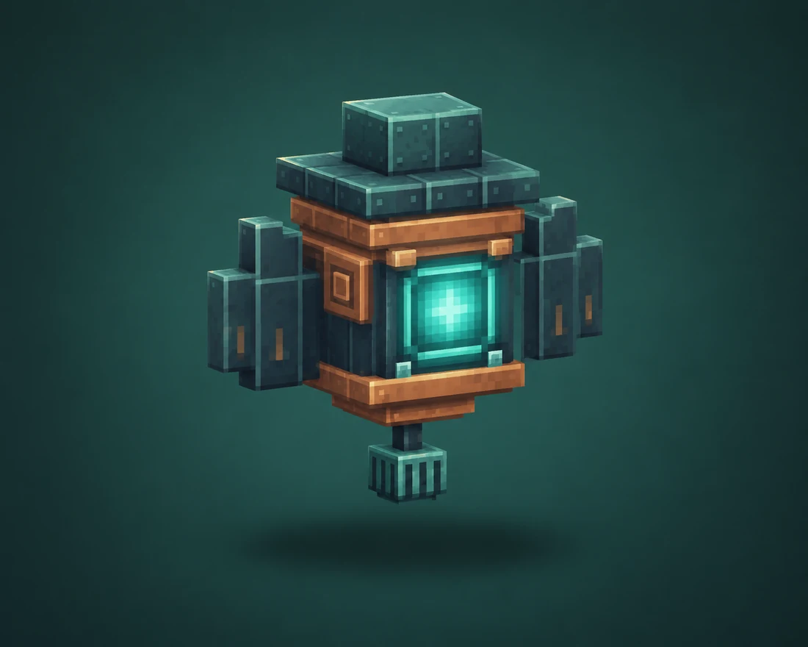
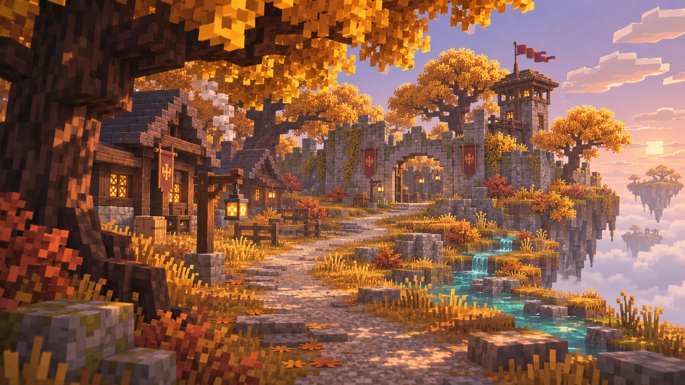
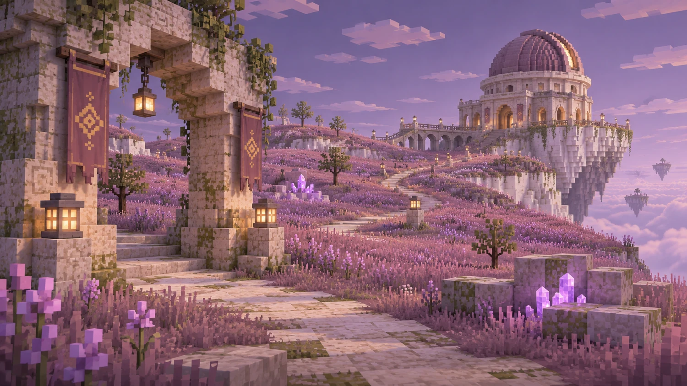
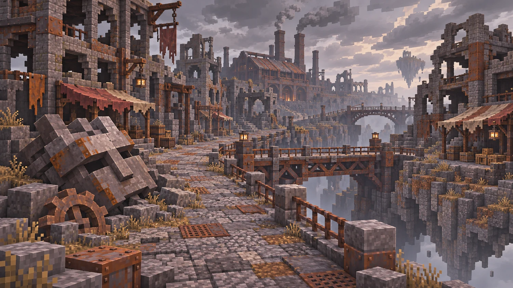
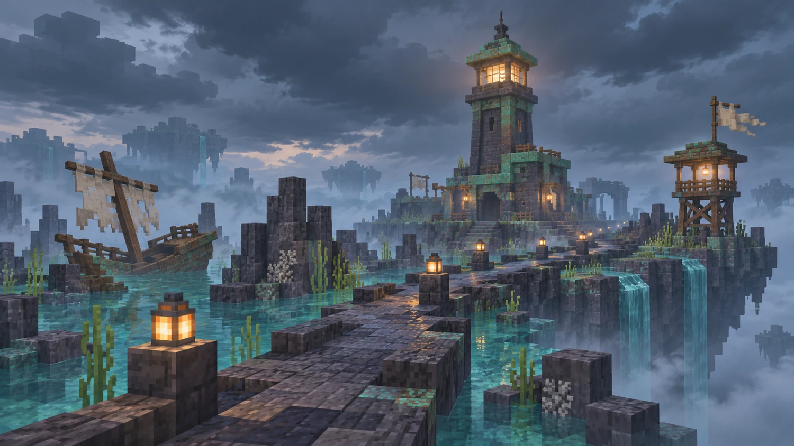

# MagicRPG

MagicRPG — аддон для Thaumcraft 4: Reforged на Minecraft 26.3. Он добавляет измерения со своей атмосферой и обитателями. Открывай их одно за другим: в каждом следующем мире испытания сложнее.

## Изменения Thaumcraft

С MagicRPG можно сканировать предметы таумометром прямо в инвентаре, проверять стабильность алтаря и видеть состав аспектов на поле исследований. [Полный список доработок Thaumcraft](docs/thaumcraft-changes.md).

## Чудовищные твари


*Мобы отрисованы из игровых моделей и текстур MagicRPG.*

### Боссы

| Янтарный стрелок | Паладин-хранитель | Лоцман бури |
| :---: | :---: | :---: |
|  |  |  |

## Златолесье



Янтарная трава покрывает тропы между золотодревами. У поваленных стволов шуршат короеды, над полянами кружат медовые мотыльки. За деревней, во дворе разбитой крепости, ждёт Янтарный стрелок в светлом капюшоне с золотой каймой и длинном зелёном плаще. Даже в обломке его лука из золотодрева ещё теплится магия янтарных пут.

## Лиловые луга



У древней арки над розовато-лиловой травой висят вымпелы с золотыми знаками. Древние кристаллы освещают молодые деревца, а у белых гряд мелькают звёздные зайцы. Меловые стражи бродят у скал, где старая обсерватория нависает над обрывом. Под лугами освещённые каналы погребённого города ведут к архиву, кристальному залу и лестницам в крипту. По галереям ходят пустые доспехи, а под светящейся печатью над воротами ждёт паладин в светлых плитах с бронзовой окантовкой. В его груди тлеет лиловое ядро, над плитами зала звенит двуручный клинок. Среди трофеев и находок лугов скрыты детали Маховика времени, способного ненадолго ускорить ход всего мира.

Древний торговец меняет трофеи с гряд и из погребённого города на лиловые доспехи. Вместе их пластины помогают ранам затягиваться. Тауматурги Лугов держали запасной комплект в зачарованном мешочке.

## Железные пустоши



Под пепельным небом ржавеют заводы, многоэтажные дома и два моста над разломом. В квартирах остались лежанки, на рынке провисли тенты, а у литейной ещё различимы верстаки и дымоходы. У проспекта лежат обломки железных великанов. Дальше колоссы и большие железные големы всё ещё сражаются с опустошёнными, мясными титанами и заражёнными тауматургами.

## Грозовые рифы



Тёмные базальтовые зубцы поднимаются из бирюзовых отмелей. У западной тропы утопленники бродят по палубе разбитого судна, а в окнах сигнальной башни на востоке виден маяк. У маяка ждёт пробуждения Лоцман бури. Между его медными створками теплится сердце, которое помогает ныряльщикам дышать под водой.

## Сборка

Установи **JDK 25** и укажи его в `JAVA_HOME`. Gradle отдельно устанавливать не нужно. Для сборки и запуска используются следующие JAR:

- `thaumcraft-4-reforged-1.1.3-26.3.jar`
- `TerraBlender-neoforge-26.3-26.3.0.0.9.jar`

Gradle ищет эти файлы сначала в `libs/`, затем в каталоге из `-PprofileMods`. На Windows без этого параметра используется `%APPDATA%\.minecraft\mods`. Reforged и TerraBlender устанавливаются отдельно и не входят в артефакт MagicRPG.

```powershell
.\gradlew.bat build -x test
# Если моды хранятся в другом каталоге
.\gradlew.bat build -x test '-PprofileMods=D:\Minecraft\test-profile\mods'
```

Первая сборка загружает Gradle и зависимости, поэтому ей нужен доступ к сети. Результат — `build/libs/magicrpg-<версия>-26.3.jar`. Для установки положи его в `mods` вместе с Reforged и TerraBlender.

## Локальная проверка

| Команда на Windows | Каталог запуска |
| --- | --- |
| `.\gradlew.bat runClient` | `run/client/` |
| `.\gradlew.bat runServer` | `run/server/` |

При первом запуске выделенный сервер потребует принять Minecraft EULA в своём каталоге. Эти команды используют окружение разработки. Для проверки установочного JAR положи его в отдельный профиль или отдельный сервер с нужными зависимостями.

Версия разработки — NeoForge `26.3.0.115`. Нижняя граница в метаданных Reforged 1.1.3 — `26.3.0.57-beta`. Игра запускалась на `26.3.0.115`, в том числе с Sodium и Horizon Iris.

- [Релиз Reforged 1.1.3 для Minecraft 26.3](https://github.com/notlikethiss/thaumcraft-4-reforged/releases/tag/26.3)
- [Исходники Reforged по тегу 26.3](https://github.com/notlikethiss/thaumcraft-4-reforged/tree/26.3)
- [Инструкции для Codex](AGENTS.md)

## Разработка

**Boss Engine** — новый внутренний Java API MagicRPG для создания боссов. В нём можно задавать фазы боя, расписание атак, зоны предупреждения и урона, временные изменения арены и анимации моделей по ключевым кадрам. Сервер управляет боем и передаёт клиенту момент начала анимации. Паладин-хранитель в Лиловых лугах использует этот API.

- [Документация Boss Engine и примеры способностей](docs/boss-engine/README.md)
- [Маршруты по коду и ресурсам](docs/development-workflows.md)
- [Пересборка карты Златолесья](docs/development-workflows.md#пересборка-карты-златолесья)
